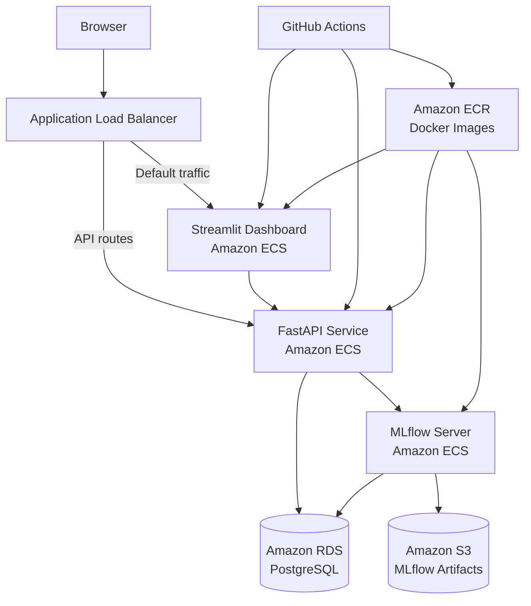

# MachineGuard

MachineGuard is an end-to-end **predictive maintenance and MLOps platform** built using the NASA IMS Bearing Dataset.

The project processes vibration signals from industrial bearings, extracts condition-monitoring features, detects abnormal machine behaviour with machine learning, and exposes the results through a production-style cloud architecture.

MachineGuard includes the complete workflow from raw sensor data to a deployed monitoring dashboard:

- vibration signal processing
- feature engineering
- anomaly detection
- experiment and model tracking with MLflow
- PostgreSQL persistence
- REST API with FastAPI
- interactive Streamlit dashboard
- Docker containerization
- automated testing
- CI/CD with GitHub Actions
- AWS deployment using ECS, ECR, RDS, S3, and an Application Load Balancer

---

## Demo

MachineGuard running end-to-end on AWS:


---

## Dashboard

The deployed dashboard provides:

- live bearing-condition prediction
- current bearing health
- anomaly scores
- historical vibration monitoring
- anomaly-rate statistics
- date filtering
- recent measurement inspection

Current production dataset:

| Metric | Value |
|---|---:|
| Measurements | 2,156 |
| Anomalous measurements | 826 |
| Anomaly rate | 38.3% |
| Minimum anomaly score | -0.2618 |

The historical plots show the evolution of vibration behaviour throughout the NASA IMS run-to-failure experiment.

---

## Dataset

MachineGuard uses the **NASA IMS Bearing Dataset**, a run-to-failure bearing dataset collected by the Center for Intelligent Maintenance Systems.

The current implementation focuses on:

```text
IMS Set 1
Bearing 4
X-axis vibration
```

Each raw file contains:

- 20,480 vibration samples
- 20 kHz sampling frequency
- measurements from multiple bearings and channels
- timestamped observations collected throughout the experiment

The experiment covers:

```text
2003-10-22 → 2003-11-25
```

Bearing 4 eventually developed a **roller defect**, making the dataset suitable for degradation monitoring and anomaly detection.

---

## Signal processing

Each raw vibration signal is transformed into a compact feature vector.

### Time-domain features

MachineGuard extracts:

- RMS
- standard deviation
- peak amplitude
- crest factor
- kurtosis

### Frequency-domain features

The FFT spectrum is used to calculate:

- dominant frequency
- spectral energy

Each raw vibration file therefore becomes one structured observation:

```text
timestamp
rms
std
peak
crest_factor
kurtosis
dominant_frequency
spectral_energy
```

This converts the original high-dimensional signal into features suitable for machine learning, persistence, and monitoring.

---

## Anomaly detection

The primary model is an **Isolation Forest**.

The model is trained only on an initial period assumed to represent healthy machine behaviour:

```text
Healthy training cutoff:
2003-11-15
```

Features are standardized using `StandardScaler` before training.

Main configuration:

```text
Model: Isolation Forest
n_estimators: 200
contamination: auto
random_state: 42
```

MachineGuard uses a custom anomaly threshold estimated from healthy data:

```text
-0.06108184766069839
```

A measurement is classified as anomalous when:

```text
anomaly_score < threshold
```

This provides both:

- a continuous anomaly score
- a binary anomaly flag

---

## MLflow

MachineGuard uses **MLflow** for experiment tracking and model management.

The logged inference pipeline contains:

- Isolation Forest model
- fitted `StandardScaler`
- anomaly threshold
- run metadata and parameters

The production inference service retrieves the latest completed model run and loads the corresponding artifacts.

In AWS:

```text
MLflow tracking server
        ↓
Amazon RDS PostgreSQL
        +
Amazon S3 artifact storage
```

MLflow itself runs as an ECS service.

---

## Database

MachineGuard uses PostgreSQL to persist bearing metadata, extracted features, and prediction results.

Main application tables:

```text
bearings
measurements
```

A measurement contains:

```text
timestamp
rms
std
peak
crest_factor
kurtosis
dominant_frequency
spectral_energy
anomaly_score
anomaly_flag
```

The production database runs on **Amazon RDS for PostgreSQL**.

The complete historical dataset contains:

```text
2,156 measurements
826 anomalous measurements
```

---

## FastAPI service

MachineGuard exposes model inference and historical data through FastAPI.

### Health check

```http
GET /health
```

Example response:

```json
{
  "status": "ok",
  "service": "machineguard"
}
```

### Historical measurements

```http
GET /measurements
```

Returns historical feature values together with anomaly scores and flags stored in AWS RDS.

### Prediction

```http
POST /predict
```

Example request:

```json
{
  "rms": 0.063,
  "std": 0.063,
  "peak": 0.36,
  "crest_factor": 5.7,
  "kurtosis": 3.4,
  "dominant_frequency": 45.0,
  "spectral_energy": 100.0
}
```

Example response:

```json
{
  "anomaly_score": -0.2124,
  "anomaly_flag": true,
  "status": "ANOMALOUS"
}
```

The model pipeline is cached after its first load so repeated prediction requests do not reload the model unnecessarily.

---

## Streamlit dashboard

The Streamlit dashboard communicates with FastAPI instead of connecting directly to the production database.

Historical monitoring follows:

```text
Streamlit
    ↓
GET /measurements
    ↓
FastAPI
    ↓
Amazon RDS
```

Live inference follows:

```text
Streamlit
    ↓
POST /predict
    ↓
FastAPI
    ↓
MLflow model
```

This keeps the presentation layer separated from model-serving and database infrastructure.

---

## AWS architecture

The production system is deployed on AWS.



### Application Load Balancer routing

The ALB separates dashboard traffic from API traffic.

```text
/health
/predict
/measurements
        → FastAPI

/docs*
/openapi.json
        → FastAPI

everything else
        → Streamlit
```

The ECS application ports are not exposed directly to the internet.

The ECS security group allows:

```text
5000 → internal ECS communication
8000 → Application Load Balancer only
8501 → Application Load Balancer only
```

---

## Containerization

The application is packaged with Docker.

A single MachineGuard image contains the Python package and application dependencies.

Different ECS services reuse the same image with different commands.

### FastAPI

```bash
uvicorn machineguard.api.main:app \
  --host 0.0.0.0 \
  --port 8000
```

### Streamlit

```bash
streamlit run src/machineguard/dashboard/app.py \
  --server.address=0.0.0.0 \
  --server.port=8501
```

### MLflow

MLflow is also deployed as an ECS service and uses:

- Amazon RDS as its backend store
- Amazon S3 for model artifacts

This architecture allows the main application components to be deployed and managed independently.

---

## CI/CD

MachineGuard uses **GitHub Actions** for automated testing and deployment.

### Continuous integration

On pushes to `main` and pull requests, the test workflow runs the Python test suite.

Current tests cover:

- FastAPI behaviour
- feature extraction
- frequency-domain feature computation
- time-domain feature computation

The current test suite contains:

```text
14 passing tests
```

### Continuous deployment

After changes are pushed to `main`, GitHub Actions:

```text
Checkout source
      ↓
Authenticate to AWS using OIDC
      ↓
Build ARM64 Docker image
      ↓
Push image to Amazon ECR
      ↓
Render new FastAPI task definition
      ↓
Deploy FastAPI ECS service
      ↓
Render new Streamlit task definition
      ↓
Deploy Streamlit ECS service
```

Docker images are tagged using both:

```text
latest
Git commit SHA
```

This allows deployed images to be associated with exact source-code revisions.

AWS authentication uses **GitHub OIDC and IAM roles**, so permanent AWS access keys do not need to be stored as GitHub secrets.

---

## Project structure

```text
machineguard/
├── .github/
│   └── workflows/
│       ├── deploy.yml
│       └── tests.yml
│
├── data/
│   ├── raw/
│   └── processed/
│
├── notebooks/
│   ├── 01_data_exploration.ipynb
│   ├── 02_feature_analysis.ipynb
│   └── 03_baseline_ml.ipynb
│
├── src/
│   └── machineguard/
│       ├── api/
│       │   └── main.py
│       │
│       ├── dashboard/
│       │   ├── app.py
│       │   ├── api_client.py
│       │   └── data.py
│       │
│       ├── data/
│       │   ├── ingestion.py
│       │   ├── load_processed.py
│       │   └── replay.py
│       │
│       ├── database/
│       │   ├── connection.py
│       │   └── schema.sql
│       │
│       ├── features/
│       │   ├── extraction.py
│       │   ├── frequency_domain.py
│       │   └── time_domain.py
│       │
│       └── models/
│           ├── inference.py
│           ├── score_history.py
│           └── train.py
│
├── tests/
├── Dockerfile
├── docker-compose.yml
├── pyproject.toml
└── README.md
```

---

## Running locally

### Clone the repository

```bash
git clone https://github.com/amedeone03/machineguard.git
cd machineguard
```

### Create a virtual environment

```bash
python3 -m venv .venv
source .venv/bin/activate
```

### Install the project

```bash
pip install -e .
```

### Run tests

```bash
pytest
```

### Run FastAPI

```bash
uvicorn machineguard.api.main:app \
  --host 0.0.0.0 \
  --port 8000
```

### Run Streamlit

```bash
streamlit run src/machineguard/dashboard/app.py
```

Docker Compose can also be used to start the local development environment containing PostgreSQL, MLflow, FastAPI, and Streamlit.

---

## Technologies

### Machine learning and signal processing

- Python
- NumPy
- pandas
- SciPy
- scikit-learn

### MLOps and backend

- MLflow
- FastAPI
- PostgreSQL
- psycopg
- Pydantic

### Visualization

- Streamlit
- Altair
- Matplotlib

### Infrastructure

- Docker
- Amazon ECS
- AWS Fargate
- Amazon ECR
- Amazon RDS
- Amazon S3
- Application Load Balancer
- AWS IAM
- AWS Secrets Manager
- Amazon CloudWatch

### CI/CD

- GitHub Actions
- GitHub OIDC
- pytest

---

## Engineering goals

MachineGuard was designed not only as an anomaly-detection experiment, but as an exercise in building a complete production-oriented machine-learning system.

The project demonstrates:

- processing real industrial sensor data
- designing reusable signal-processing pipelines
- feature engineering
- separating training and inference
- avoiding data leakage during anomaly-model training
- model artifact management
- database-backed applications
- REST API design
- interactive monitoring dashboards
- Docker containerization
- cloud networking
- IAM and secrets management
- automated testing
- CI/CD
- production debugging across multiple distributed services

---

## Future improvements

Potential extensions include:

- `NORMAL`, `DEGRADING`, and `CRITICAL` health stages
- Remaining Useful Life estimation
- additional NASA IMS bearings and experiments
- real-time sensor streaming
- drift monitoring
- automated retraining
- CloudWatch alarms
- HTTPS and a custom domain
- private ECS subnets
- API pagination
- auto-scaling
- comparison with autoencoders and other anomaly-detection methods
- richer operational alerting

---

## Status

**End-to-end system deployed successfully.**

Current workflow:

```text
Raw vibration data
→ signal processing
→ feature extraction
→ anomaly detection
→ MLflow tracking
→ PostgreSQL persistence
→ FastAPI inference
→ Streamlit monitoring
→ Docker
→ AWS deployment
→ automated CI/CD
```