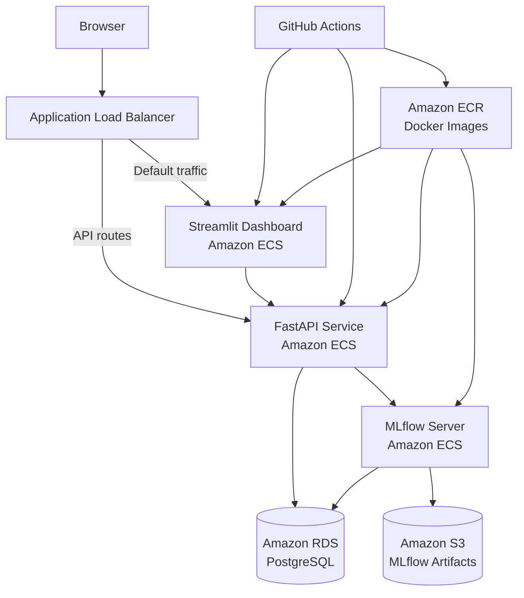

# MachineGuard

MachineGuard is an end-to-end **predictive maintenance and MLOps platform** built using the NASA IMS Bearing Dataset.

The project processes vibration signals from industrial bearings, extracts condition-monitoring features, detects abnormal machine behaviour with machine learning, and exposes the results through a production-style cloud architecture.

MachineGuard includes the complete workflow from raw sensor data to a deployed monitoring dashboard:

- vibration signal processing
- feature engineering
- anomaly detection
- experiment and model tracking with MLflow
- PostgreSQL persistence
- REST API with FastAPI
- interactive Streamlit dashboard
- Docker containerization
- automated testing
- CI/CD with GitHub Actions
- deployment on AWS using ECS, ECR, RDS, S3, and an Application Load Balancer

---

## Dashboard

The deployed dashboard provides:

- live bearing-condition prediction
- current bearing health
- anomaly scores
- historical vibration monitoring
- anomaly-rate statistics
- date filtering
- historical measurement inspection

Current production dataset:

| Metric | Value |
|---|---:|
| Measurements | 2,156 |
| Anomalous measurements | 826 |
| Anomaly rate | 38.3% |
| Minimum anomaly score | -0.2618 |

The final measurement sequence clearly shows the increase in vibration associated with bearing degradation near the end of the experiment.

---

## Dataset

MachineGuard uses the **NASA IMS Bearing Dataset**, a run-to-failure bearing dataset collected by the Center for Intelligent Maintenance Systems.

The current implementation focuses on **IMS Set 1 – Bearing 4, X-axis vibration**.

Each raw file contains:

- 20,480 vibration samples
- 20 kHz sampling frequency
- measurements from multiple bearings and channels
- timestamped observations collected throughout the experiment

The experiment covers:

```text
2003-10-22 → 2003-11-25
```

Bearing 4 eventually developed a **roller defect**, making the dataset suitable for studying degradation and anomaly detection.

---

## Signal processing

Each vibration signal is transformed into a compact feature vector.

### Time-domain features

MachineGuard extracts:

- RMS
- standard deviation
- peak amplitude
- crest factor
- kurtosis

### Frequency-domain features

The FFT spectrum is used to calculate:

- dominant frequency
- spectral energy

Each raw vibration file therefore becomes one observation:

```text
timestamp
rms
std
peak
crest_factor
kurtosis
dominant_frequency
spectral_energy
```

This converts high-dimensional vibration signals into structured data suitable for machine learning and monitoring.

---

## Anomaly detection

The primary model is an **Isolation Forest**.

The model is trained only on an initial period assumed to represent healthy machine behaviour:

```text
Healthy training period:
timestamp <= 2003-11-15
```

Before training, features are standardized using `StandardScaler`.

Main configuration:

```text
Model: Isolation Forest
n_estimators: 200
contamination: auto
random_state: 42
```

Rather than relying directly on the default Isolation Forest classification boundary, MachineGuard uses a custom threshold estimated from healthy data.

```text
Anomaly threshold:
-0.06108184766069839
```

A measurement is considered anomalous when:

```text
anomaly_score < threshold
```

This provides a continuous health indicator in addition to the binary anomaly flag.

---

## MLflow

MachineGuard uses **MLflow** for model and experiment management.

The tracked inference pipeline contains:

- Isolation Forest model
- fitted StandardScaler
- anomaly threshold
- experiment metadata

The inference service retrieves the latest completed model run from MLflow and loads the corresponding artifacts.

In the AWS deployment:

```text
MLflow tracking server
        ↓
PostgreSQL / Amazon RDS
        +
Amazon S3 artifact storage
```

MLflow itself runs as an ECS service.

---

## Database

MachineGuard uses PostgreSQL to persist bearing metadata, extracted features, and prediction results.

Main tables:

```text
bearings
measurements
```

A measurement contains both signal features and ML outputs:

```text
timestamp
rms
std
peak
crest_factor
kurtosis
dominant_frequency
spectral_energy
anomaly_score
anomaly_flag
```

The production database runs on **Amazon RDS for PostgreSQL**.

---

## FastAPI inference service

MachineGuard exposes model inference and historical data through FastAPI.

### Health check

```http
GET /health
```

Example response:

```json
{
  "status": "ok",
  "service": "machineguard"
}
```

### Historical measurements

```http
GET /measurements
```

Returns the measurements stored in PostgreSQL together with their anomaly scores and flags.

### Prediction

```http
POST /predict
```

Example request:

```json
{
  "rms": 0.063,
  "std": 0.063,
  "peak": 0.36,
  "crest_factor": 5.7,
  "kurtosis": 3.4,
  "dominant_frequency": 45.0,
  "spectral_energy": 100.0
}
```

Example response:

```json
{
  "anomaly_score": -0.2124,
  "anomaly_flag": true,
  "status": "ANOMALOUS"
}
```

The model pipeline is cached after its first load so repeated prediction requests do not reload the model unnecessarily.

---

## Streamlit dashboard

The Streamlit dashboard consumes the FastAPI service rather than querying the production database directly.

Historical monitoring follows:

```text
Streamlit
    ↓
GET /measurements
    ↓
FastAPI
    ↓
Amazon RDS
```

Live inference follows:

```text
Streamlit
    ↓
POST /predict
    ↓
FastAPI
    ↓
MLflow model
```

This keeps the presentation layer separated from database and model infrastructure.

---

## AWS architecture

The production system is deployed on AWS.



### ALB routing

The Application Load Balancer separates dashboard traffic from API traffic.

```text
/health
/predict
/measurements
        → FastAPI

/docs*
/openapi.json
        → FastAPI

everything else
        → Streamlit
```

The ECS tasks are not directly exposed on their application ports.

The ECS security group allows:

```text
5000 → internal ECS communication
8000 → Application Load Balancer only
8501 → Application Load Balancer only
```

---

## Containerization

The application is packaged using Docker.

A single image contains the MachineGuard Python package and dependencies.

The same image can run different application components by overriding the container command.

### FastAPI

```bash
uvicorn machineguard.api.main:app \
  --host 0.0.0.0 \
  --port 8000
```

### Streamlit

```bash
streamlit run src/machineguard/dashboard/app.py \
  --server.address=0.0.0.0 \
  --server.port=8501
```

### MLflow

MLflow is also deployed as a containerized ECS service.

This approach keeps deployment consistent while allowing each component to scale independently.

---

## CI/CD

MachineGuard uses **GitHub Actions** for automated testing and deployment.

### Test pipeline

On pushes, the test workflow executes the Python test suite.

Current test coverage includes:

- API behaviour
- feature extraction
- frequency-domain processing
- time-domain processing

### Deployment pipeline

After changes are pushed to `main`, GitHub Actions:

```text
Checkout source
      ↓
Authenticate to AWS using OIDC
      ↓
Build ARM64 Docker image
      ↓
Push image to Amazon ECR
      ↓
Create new API ECS task definition
      ↓
Deploy FastAPI service
      ↓
Create new dashboard ECS task definition
      ↓
Deploy Streamlit service
```

Images are tagged using the Git commit SHA as well as `latest`, allowing deployments to be associated with specific source-code revisions.

No permanent AWS access keys are stored in GitHub because authentication uses **GitHub OIDC and IAM roles**.

---

## Project structure

```text
machineguard/
├── .github/
│   └── workflows/
│       ├── deploy.yml
│       └── tests.yml
│
├── data/
│   ├── raw/
│   └── processed/
│
├── notebooks/
│   ├── 01_data_exploration.ipynb
│   ├── 02_feature_analysis.ipynb
│   └── 03_baseline_ml.ipynb
│
├── src/
│   └── machineguard/
│       ├── api/
│       │   └── main.py
│       │
│       ├── dashboard/
│       │   ├── app.py
│       │   ├── api_client.py
│       │   └── data.py
│       │
│       ├── data/
│       │   ├── ingestion.py
│       │   ├── load_processed.py
│       │   └── replay.py
│       │
│       ├── database/
│       │   ├── connection.py
│       │   └── schema.sql
│       │
│       ├── features/
│       │   ├── extraction.py
│       │   ├── frequency_domain.py
│       │   └── time_domain.py
│       │
│       └── models/
│           ├── inference.py
│           ├── score_history.py
│           └── train.py
│
├── tests/
├── Dockerfile
├── docker-compose.yml
├── pyproject.toml
└── README.md
```

---

## Running locally

### 1. Clone the repository

```bash
git clone https://github.com/amedeone03/machineguard.git
cd machineguard
```

### 2. Create a virtual environment

```bash
python3 -m venv .venv
source .venv/bin/activate
```

### 3. Install the project

```bash
pip install -e .
```

### 4. Run tests

```bash
pytest
```

### 5. Run the API

```bash
uvicorn machineguard.api.main:app \
  --host 0.0.0.0 \
  --port 8000
```

### 6. Run the dashboard

```bash
streamlit run src/machineguard/dashboard/app.py
```

Docker Compose can also be used to start the local PostgreSQL, MLflow, API, and dashboard development environment.

---

## Technologies

### Machine learning and signal processing

- Python
- NumPy
- pandas
- SciPy
- scikit-learn

### MLOps and backend

- MLflow
- FastAPI
- PostgreSQL
- psycopg
- Pydantic

### Visualization

- Streamlit
- Altair
- Matplotlib

### Infrastructure

- Docker
- Amazon ECS
- AWS Fargate
- Amazon ECR
- Amazon RDS
- Amazon S3
- Application Load Balancer
- AWS IAM
- AWS Secrets Manager
- CloudWatch

### CI/CD

- GitHub Actions
- GitHub OIDC
- pytest

---

## Engineering goals

MachineGuard was designed not only as an anomaly-detection experiment, but as an exercise in building a complete ML system.

The project demonstrates:

- processing real sensor data
- designing reusable feature pipelines
- separating training and inference
- avoiding data leakage when training anomaly detectors
- model artifact management
- database-backed applications
- REST API design
- interactive monitoring
- containerization
- cloud networking
- IAM and secrets management
- automated testing
- automated cloud deployment
- production debugging across multiple services

---

## Future improvements

Potential extensions include:

- degradation-stage classification such as `NORMAL`, `DEGRADING`, and `CRITICAL`
- Remaining Useful Life estimation
- additional NASA IMS bearings and experiments
- streaming sensor ingestion
- model-drift monitoring
- CloudWatch alarms
- HTTPS and a custom domain
- private ECS subnets
- API pagination
- model retraining pipelines
- comparison with autoencoders or other anomaly-detection approaches
- richer operational alerting

---

## Status

**End-to-end system deployed successfully.**

The current version supports:

```text
Raw vibration data
→ feature extraction
→ anomaly detection
→ MLflow tracking
→ PostgreSQL persistence
→ FastAPI inference
→ Streamlit monitoring
→ Docker
→ AWS deployment
→ automated CI/CD
```