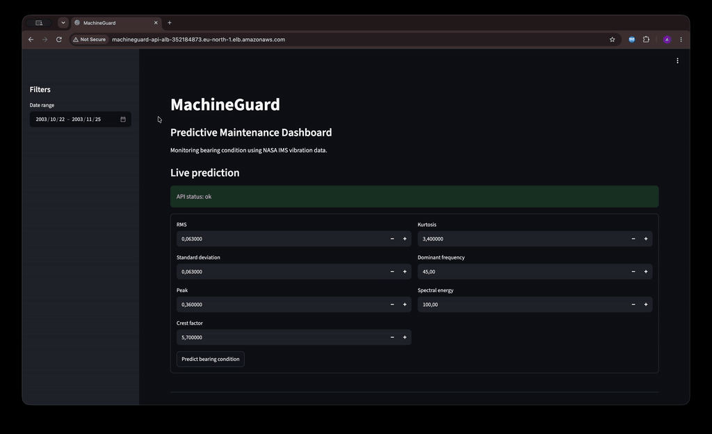
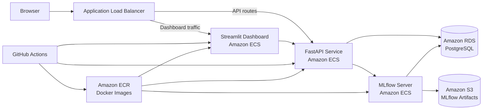

# MachineGuard

Production-oriented predictive maintenance system for bearing anomaly detection using vibration signals, machine learning, MLflow, FastAPI, Streamlit, Docker, and AWS.



<p align="center">
  
  
  
  
  
</p>

---

## Overview

MachineGuard is an end-to-end **predictive maintenance and MLOps platform** built on the NASA IMS Bearing Dataset.

The system transforms raw vibration signals into engineered condition-monitoring features, detects abnormal machine behaviour with an Isolation Forest model, stores historical predictions in PostgreSQL, and exposes the results through a deployed monitoring dashboard.

The project covers the complete machine-learning lifecycle:

```text
Raw vibration data
→ signal processing
→ feature extraction
→ anomaly detection
→ MLflow tracking
→ PostgreSQL persistence
→ FastAPI inference
→ Streamlit monitoring
→ Docker
→ AWS deployment
→ automated CI/CD
```

---

## Why this project matters

MachineGuard is not only a machine-learning experiment.

It was designed as a complete production-oriented ML system, with particular focus on:

- processing real industrial sensor data
- separating training and inference
- avoiding leakage when defining healthy training data
- experiment and artifact tracking
- database-backed monitoring
- API-based model serving
- containerized deployment
- cloud networking
- secrets and IAM management
- automated testing
- automated deployment

This makes the project closer to a real MLOps workflow than a standalone notebook-based model.

---

## Current deployment

| Metric | Value |
|---|---:|
| Measurements processed | 2,156 |
| Anomalous measurements | 826 |
| Anomaly rate | 38.3% |
| Minimum anomaly score | -0.2618 |
| Model | Isolation Forest |
| Database | PostgreSQL / Amazon RDS |
| Deployment | AWS ECS |
| CI/CD | GitHub Actions |

---

## Demo

The demo above shows the deployed MachineGuard system running end-to-end on AWS.

It includes:

- production dashboard
- API connectivity
- current bearing health
- historical RMS evolution
- anomaly-score evolution
- period-level statistics
- live anomaly prediction

The dashboard is served through an AWS Application Load Balancer and communicates with the FastAPI backend for both historical monitoring and live inference.

---

## Architecture



The system has one public entry point through the Application Load Balancer.

---

## Key engineering decisions

### Healthy-only model training

The anomaly detector is trained only on an initial time period assumed to represent healthy bearing behaviour.

This prevents degraded observations from contaminating the definition of normal operating conditions.

### Custom anomaly threshold

Instead of using only the default Isolation Forest classification boundary, MachineGuard derives a threshold from the distribution of anomaly scores in healthy data.

This provides a more interpretable decision boundary for the specific dataset.

### API-first dashboard architecture

The Streamlit dashboard does not access the production database directly.

Historical data is retrieved through FastAPI:

```text
Streamlit
    ↓
GET /measurements
    ↓
FastAPI
    ↓
Amazon RDS
```

Live predictions follow:

```text
Streamlit
    ↓
POST /predict
    ↓
FastAPI
    ↓
MLflow model
```

This keeps the presentation layer separated from persistence and model-serving logic.

### Immutable deployment images

Docker images are tagged using the Git commit SHA in addition to `latest`.

This makes each deployment traceable to an exact repository revision.

### OIDC-based AWS authentication

GitHub Actions authenticates to AWS using OpenID Connect.

No permanent AWS access keys are stored in GitHub.

---

## Dataset

MachineGuard uses the **NASA IMS Bearing Dataset**, a run-to-failure vibration dataset collected by the Center for Intelligent Maintenance Systems.

The current implementation focuses on:

```text
IMS Set 1
Bearing 4
X-axis vibration
```

Each raw observation contains:

- 20,480 vibration samples
- 20 kHz sampling frequency
- measurements from multiple bearings and channels
- timestamped files collected throughout the experiment

The experiment covers:

```text
2003-10-22 → 2003-11-25
```

Bearing 4 eventually developed a **roller defect**, making this sequence useful for studying progressive mechanical degradation.

---

## Signal processing

Each raw vibration file is transformed into a compact feature vector.

### Time-domain features

MachineGuard extracts:

- RMS
- standard deviation
- peak amplitude
- crest factor
- kurtosis

### Frequency-domain features

The FFT spectrum is used to calculate:

- dominant frequency
- spectral energy

Each vibration file therefore becomes one structured measurement:

```text
timestamp
rms
std
peak
crest_factor
kurtosis
dominant_frequency
spectral_energy
```

This reduces a raw high-dimensional vibration signal into features suitable for machine learning, storage, and monitoring.

---

## Anomaly detection

The primary model is an **Isolation Forest**.

The healthy training period is defined using the cutoff:

```text
timestamp <= 2003-11-15
```

This produces 969 samples for model training.

Before training, the features are standardized using `StandardScaler`.

Main model configuration:

```text
Model: Isolation Forest
n_estimators: 200
contamination: auto
random_state: 42
```

The custom anomaly threshold is:

```text
-0.06108184766069839
```

The threshold corresponds to the lower tail of healthy anomaly scores.

A measurement is considered anomalous when:

```text
anomaly_score < threshold
```

Example healthy observation:

```text
anomaly_score = -0.0143
anomaly = false
```

Example degraded observation:

```text
anomaly_score = -0.2136
anomaly = true
```

This gives the system both:

- a continuous anomaly score
- a binary anomaly flag

---

## MLflow

MachineGuard uses **MLflow** for experiment tracking and model management.

The tracked inference pipeline contains:

- Isolation Forest model
- fitted `StandardScaler`
- anomaly threshold
- run metadata
- model parameters

The FastAPI service retrieves the latest completed model run and loads the corresponding artifacts.

In the AWS deployment:

```text
MLflow server
    ↓
Amazon RDS
    +
Amazon S3
```

Amazon RDS is used as the MLflow backend store, while S3 stores model artifacts.

MLflow itself runs as an ECS service.

---

## Database

MachineGuard uses PostgreSQL to persist:

- bearing metadata
- extracted signal features
- anomaly scores
- anomaly flags

The main application tables are:

```text
bearings
measurements
```

A measurement contains:

```text
timestamp
rms
std
peak
crest_factor
kurtosis
dominant_frequency
spectral_energy
anomaly_score
anomaly_flag
```

The production database runs on **Amazon RDS for PostgreSQL**.

The complete historical sequence currently contains:

```text
2,156 measurements
826 anomalous measurements
```

---

## FastAPI service

MachineGuard exposes model inference and historical measurements through FastAPI.

### Health check

```http
GET /health
```

Example response:

```json
{
  "status": "ok",
  "service": "machineguard"
}
```

### Historical measurements

```http
GET /measurements
```

Returns stored measurements together with:

- extracted features
- anomaly score
- anomaly flag

### Prediction

```http
POST /predict
```

Example request:

```json
{
  "rms": 0.063,
  "std": 0.063,
  "peak": 0.36,
  "crest_factor": 5.7,
  "kurtosis": 3.4,
  "dominant_frequency": 45.0,
  "spectral_energy": 100.0
}
```

The API returns the anomaly score and classification produced by the loaded model.

The inference pipeline is cached after the first load so repeated requests do not reload the MLflow model unnecessarily.

---

## Streamlit dashboard

The dashboard provides:

- current bearing condition
- live prediction
- anomaly-score visualization
- RMS trend visualization
- anomaly statistics
- date filtering
- recent measurements

The dashboard communicates entirely through the FastAPI service rather than directly accessing the production database.

---

## AWS deployment

The production architecture uses several AWS services.

### Amazon ECS

Three containerized services run on ECS:

```text
machineguard-api-service
machineguard-dashboard-service
machineguard-mlflow-service
```

### Amazon ECR

Docker images are stored in Amazon Elastic Container Registry.

The same MachineGuard image can run different components by using different ECS commands.

### Amazon RDS

PostgreSQL stores both:

- MachineGuard application data
- MLflow backend metadata

### Amazon S3

S3 stores MLflow artifacts such as trained models.

### Application Load Balancer

The ALB routes requests based on path.

```text
/health
/predict
/measurements
        → FastAPI

/docs*
/openapi.json
        → FastAPI

everything else
        → Streamlit
```

### Security groups

The ECS security group allows:

```text
5000 → internal ECS communication
8000 → Application Load Balancer
8501 → Application Load Balancer
```

The API and dashboard application ports are therefore not exposed directly to the internet.

---

## Containerization

MachineGuard is packaged using Docker.

The same application image is reused for multiple services.

### FastAPI

```bash
uvicorn machineguard.api.main:app \
  --host 0.0.0.0 \
  --port 8000
```

### Streamlit

```bash
streamlit run src/machineguard/dashboard/app.py \
  --server.address=0.0.0.0 \
  --server.port=8501
```

### MLflow

MLflow runs as a dedicated ECS service with:

- PostgreSQL backend store
- S3 artifact storage

This keeps deployment consistent while allowing the services to operate independently.

---

## CI/CD

MachineGuard uses GitHub Actions for both continuous integration and continuous deployment.

### Continuous integration

The test workflow runs the Python test suite automatically.

Current tests cover:

- FastAPI behaviour
- feature extraction
- time-domain processing
- frequency-domain processing

Current test result:

```text
14 passed
```

### Continuous deployment

Changes pushed to `main` trigger the deployment workflow.

```text
Checkout repository
      ↓
Authenticate to AWS using OIDC
      ↓
Build ARM64 Docker image
      ↓
Push image to Amazon ECR
      ↓
Render new API task definition
      ↓
Deploy FastAPI ECS service
      ↓
Render new dashboard task definition
      ↓
Deploy Streamlit ECS service
```

Each image is tagged with:

```text
latest
<git-commit-sha>
```

This makes deployments reproducible and traceable.

---

## Project structure

```text
machineguard/
├── .github/
│   └── workflows/
│       ├── deploy.yml
│       └── tests.yml
│
├── data/
│   ├── raw/
│   └── processed/
│
├── docs/
│   └── machineguard-demo.gif
│
├── notebooks/
│   ├── 01_data_exploration.ipynb
│   ├── 02_feature_analysis.ipynb
│   └── 03_baseline_ml.ipynb
│
├── src/
│   └── machineguard/
│       ├── api/
│       │   └── main.py
│       │
│       ├── dashboard/
│       │   ├── app.py
│       │   ├── api_client.py
│       │   └── data.py
│       │
│       ├── data/
│       │   ├── ingestion.py
│       │   └── load_processed.py
│       │
│       ├── database/
│       │   ├── connection.py
│       │   └── schema.sql
│       │
│       ├── features/
│       │   ├── extraction.py
│       │   ├── frequency_domain.py
│       │   └── time_domain.py
│       │
│       └── models/
│           ├── inference.py
│           ├── score_history.py
│           └── train.py
│
├── tests/
├── Dockerfile
├── docker-compose.yml
├── pyproject.toml
└── README.md
```

---

## Running locally

### Clone the repository

```bash
git clone https://github.com/amedeone03/machineguard.git
cd machineguard
```

### Create a virtual environment

```bash
python3 -m venv .venv
source .venv/bin/activate
```

### Install the project

```bash
pip install -e .
```

### Run tests

```bash
pytest
```

### Run FastAPI

```bash
uvicorn machineguard.api.main:app \
  --host 0.0.0.0 \
  --port 8000
```

### Run Streamlit

```bash
streamlit run src/machineguard/dashboard/app.py
```

Docker Compose can also be used for the local PostgreSQL, MLflow, API, and dashboard environment.

---

## Technologies

| Area | Technologies |
|---|---|
| Machine learning | scikit-learn |
| Signal processing | NumPy, SciPy |
| Data processing | pandas |
| Model tracking | MLflow |
| API | FastAPI, Pydantic |
| Database | PostgreSQL, psycopg |
| Dashboard | Streamlit, Altair |
| Containers | Docker |
| Cloud | AWS ECS, ECR, RDS, S3, ALB |
| Security | IAM, Secrets Manager, OIDC |
| CI/CD | GitHub Actions |
| Testing | pytest |

---

## What I learned

Building MachineGuard required working across the full ML system rather than focusing only on model accuracy.

The project involved:

- understanding vibration data
- extracting physically meaningful features
- defining a healthy training regime
- designing an anomaly-detection pipeline
- tracking models and artifacts
- designing database schemas
- building REST APIs
- creating dashboards
- debugging Docker containers
- configuring AWS networking
- managing IAM permissions
- using Secrets Manager
- configuring ECS services and load balancing
- implementing GitHub Actions CI/CD
- debugging production deployment failures

The main challenge was integrating all these components into one reliable workflow.

---

## Future improvements

Possible extensions include:

- `NORMAL`, `DEGRADING`, and `CRITICAL` health stages
- Remaining Useful Life estimation
- additional NASA IMS bearings
- streaming sensor ingestion
- model-drift detection
- automated retraining
- CloudWatch alarms
- HTTPS and custom domain
- private ECS subnets
- ECS auto-scaling
- API pagination
- comparison with autoencoders
- richer operational alerting

---

## Status

**End-to-end system successfully deployed.**

MachineGuard currently supports the complete pipeline from raw vibration data to a cloud-hosted monitoring application with automated CI/CD.